# CASO PRÁCTICO: Análisis forense del archivo swapfile en Linux

## Descripción:

En esta practica realice un analisis forense del archivo de intercambio (*swapfile*) en un entorno de Linux, con el objetivo de comprender que sucede cuando un proceso necesita mas memoria RAM de la que tiene disponible y como parte de su informacion puede terminar almacenada en el disco.

Para realizar este ejercicio practico, utilce el editor de texto *Emacs* y abri el archivo `/etc/passwd`. Luego provoque una situacion de presion de memoria sobre el proceso Emacs, con el fin de obtener una copia del archivo de intercambio swapfile.
Finalmente, copie el archivo swapfile de la maquina virtual a mi sistema anfitrion y utilice Autopsy para examinar su contenido y buscar rastros de informacion.

## Objetivos:
- Comprender qué es la memoria swap y qué función cumple en Linux.

- Observar el comportamiento de un proceso cuando tiene limitada la memoria disponible.

- Comprender cómo puede producirse el intercambio de páginas de memoria entre la RAM y el disco.

- Practicar la copia de archivos desde una máquina virtual hacia el sistema anfitrión.

- Comprender como pueden quedar rastros de informacion en el archivo de intercambio.

- Utilizar Autopsy para buscar cadenas de texto y posibles eivedencias digitales.

- Familiarizarme con un procedimiento básico de análisis forense digital.

## Entorno y herramientas:
- **Sistema operativo** : Ubuntu Linux
- **Virtualizacion** : Oracle VirtualBox / VM Ware
- **Editor de texto** : Emacs
- **Herramienta forense** : Autopsy
- **Evidencia analizada**: archivo de intercambio swapfile.

## Conceptos fundamentales a tener en cuenta:

### Que es la memoria swap?
La memoria swap es una porción del disco duro o unidad de almacenamiento (HDD o SSD) que el sistema operativo utiliza como memoria virtual para ampliar la memoria RAM física. Dependiendo la comfiguracion del sistema, Linux puede trasladar paginas de memoria RAM al area de intercambio para gestionar la memoria disponible.
La memoria swap se utiliza para aliviar la memoria, evitar caidas del sistema y para casos de hibernacion.

### Que es el archivo `/etc/passwd`?
Es un archivo de linux que contiene informacion sobre cuentas de usuario locales, como sus nombres, identificadores y otros datos relacionados con las cuentas.

*NOTA*: `/etc/passwd` normalmente no almacena las contraseñas en texto plano. Los campos de sus registros contienen información de las cuentas y, generalmente, una referencia al archivo donde se guardan los hashes de contraseñas.

## Por que es importante el swapfile desde el punto de vista forense?
Desde el punto de vista de la informática forense, considero que el archivo de intercambio swapfile es importante, ya que puede conservar rastros de datos que estuvieron previamente almacenados en la memoria RAM.

Estos rastros pueden resultar útiles durante una investigación, debido a que ciertos fragmentos de información pueden permanecer almacenados en disco incluso después de cerrar una aplicación. Por este motivo, el archivo de intercambio puede conformar una fuente complementaria de evidencias durante un análisis forense digital.

Ahora bien, la recuperación de información no te la garantizo, ya que dependera de diversos factores, como el comportamiento del sistema, la presión de memoria, la configuración y otros aspectos. Además, la presencia de determinados datos en el archivo no demuestra por sí sola que un usuario haya realizado una acción específica.

### ¿Qué datos sensibles puede contener?

El archivo swapfile puede contener fragmentos de información sensible que estuvieron previamente en la memoria RAM, por ejemplo:

| Tipo de información | Ejemplos |
|---|---|
| **Credenciales** | Contraseñas ingresadas, fragmentos de credenciales y datos de autenticación. |
| **Información de usuarios** | Nombres de usuario, direcciones de correo y datos de cuentas. |
| **Navegación web** | URLs, fragmentos de páginas visitadas, búsquedas y contenido de formularios. |
| **Mensajes privados** | Fragmentos de correos electrónicos, chats y mensajes. |
| **Documentos** | Texto de archivos abiertos con editores como Emacs, LibreOffice o lectores PDF. |
| **Información de red** | Direcciones IP, nombres de dominio y otros datos de conexiones. |
| **Claves criptográficas** | Claves privadas, claves SSH o material criptográfico que estuvo en memoria. |
| **Datos personales** | Números de teléfono, información de contacto y otros datos ingresados en aplicaciones. |

Estos tipos de información representan posibles artefactos de interés en investigaciones de informática forense y análisis de memoria.

### A considerar:

*Es importante tener en cuenta que el archivo de intercambio no siempre contiene todos estos tipos de información, ya que esto depende de los datos que hayan utilizado las aplicaciones y de la gestión de memoria realizada por el sistema.*

*Por eso, es necesario **evaluar la información encontrada** teniendo en cuenta **el contexto** en el que se obtuvo y considerar **otras evidencias** para respaldar los resultados antes de **establecer conclusiones**.*

## Procedimiento:

### 1. Identificación del archivo de intercambio.
Primero, verificamos la ubicación y el tamaño del archivo swapfile.
Utilizando los siguientes comandos:

    tree / -L 1

    ls -lh /swapfile

Podemos observar que el archivo swapfile se encuentra en el directorio raíz del sistema (/) y tiene un tamaño máximo aproximado de 948 MB.

| 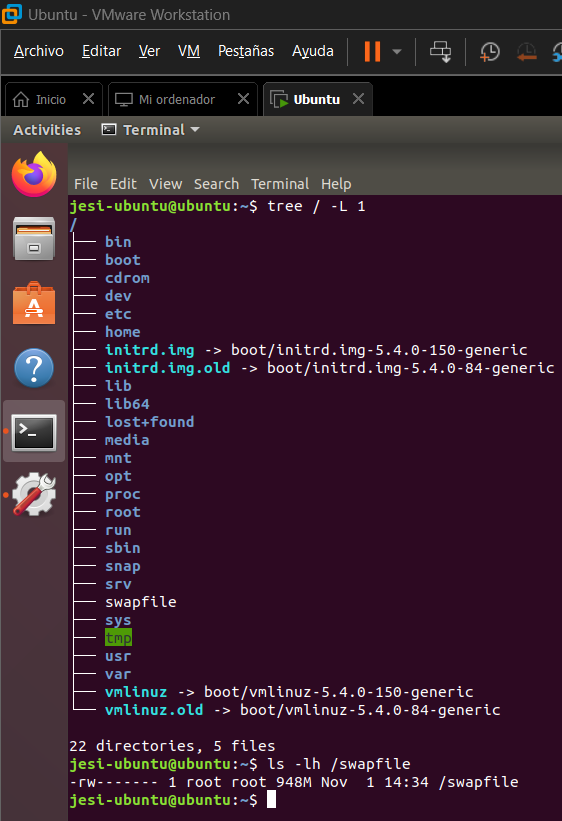 |
|:------------------------------------------------------:|
| *Captura 1 — Identificación del swap*           |

***Aclaracion**: Para poder utilizar el comando `tree` se requiere instalarlo ejecutando el siguiente comando porque por defecto no viene instalado en el S.O:*

    sudo apt install tree

Tree es una herramienta que me permite visualizar la estructura de carpetas y archivos en forma de árbol.

### 2. Apertura del archivo /etc/passwd con Emacs.
Segundo, abrimos el archivo `/etc/passwd` mediante el editor *Emacs* (o en cualquier editor de texto).

Utilizando el siguiente comando:

    emacs /etc/passwd

Este archivo contiene información de las cuentas de usuario del sistema, como sus nombres, identificadores y directorios personales. Al abrirlo con Emacs, el programa carga su contenido en memoria ram para poder trabajar con él.

El proceso Emacs tiene una cantidad de ram asociada que puede consumir pero por el momento no llegó al limite y por lo tanto  podemos observar que carga este archivo sin ningún problema.

| 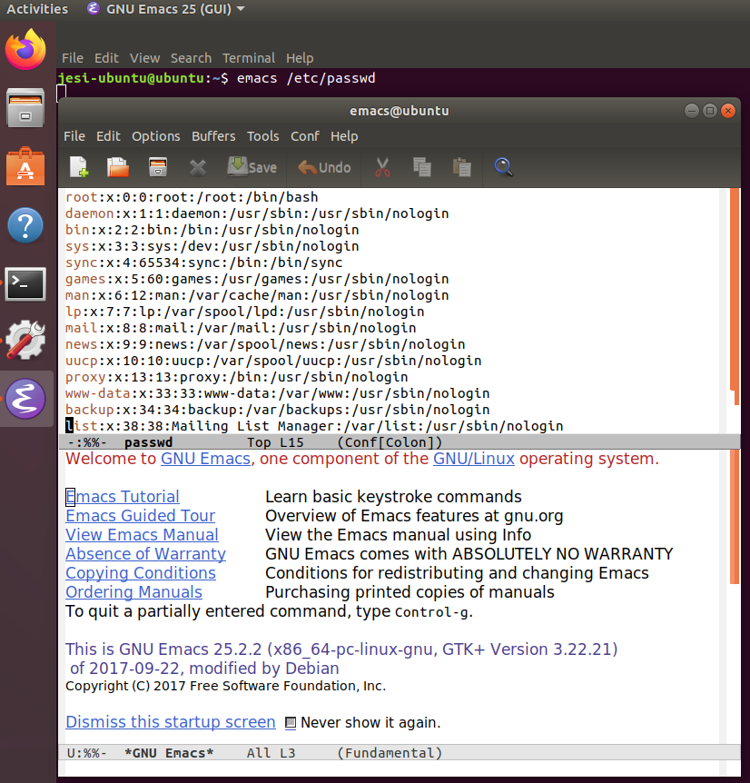 |
|:------------------------------------------------------:|
| *Captura 2 — Archivo /etc/passwd abierto en Emacs*          |

***Aclaracion**: Para poder usar el editor Emacs se necesita instalarlo ejecutando el siguiente comando porque por defecto no viene instalado en el S.O:*

    sudo apt install emacs

### 3. Identificación del proceso Emacs.
En este paso, suspendemos temporalmente Emacs mediante el atajo Ctrl + Z. Luego buscamos su identificador de proceso (PID) para poder aplicar una restricción de recursos. Usando el siguiente comando:

    ps

| 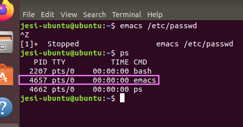 |
|:------------------------------------------------------:|
| *Captura 3 — Identificación del PID*        |

### 4. Limitación del espacio de direcciones virtuales.
Ahora copiamos el PID de Emacs y lo utilizaremos en el siguiente comando:

    prlimit --as=1000 --pid [PID]

En este comando, [PID] debe ser reemplazado por el identificador real del proceso Emacs.

La opción --as establece un límite al espacio de direcciones virtuales del proceso. En este caso, configuramos un límite de 1000 bytes para provocar una restricción que impida a Emacs continuar funcionando normalmente.

| 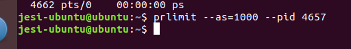 |
|:------------------------------------------------------:|
| *Captura 4 — Configuración del límite*       |

### 5. Reanudación del proceso y observación de su comportamiento.
Luego ejecutaremos el siguiente comando:

    fg

Este comando hace que el proceso Emacs vuelva a primer plano.

A continuación, intentamos continuar trabajando con Emacs, por ejemplo creando un nuevo archivo en la interfaz grafica de Emacs, con el fin de observar cómo responde al límite aplicado.
Emacs deja de responder temporalmente y posteriormente presenta un error relacionado con la asignación de memoria.

El objetivo de este paso, es observar el comportamiento del proceso ante la restricción de recursos.

| 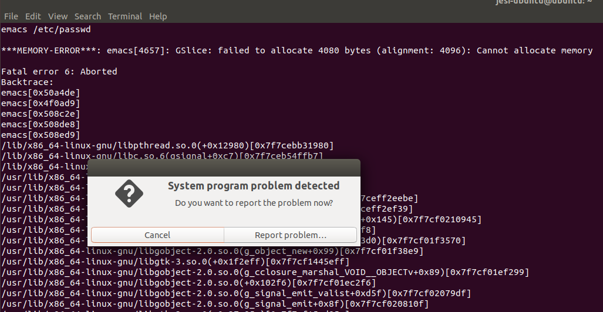 |
|:------------------------------------------------------:|
| *Captura 5 — Comportamiento de Emacs*       |

### 6. Copia del archivo de intercambio.
Después del experimento, vamos a obtener una copia del archivo swapfile para analizarla fuera del sistema en ejecución.
Utilizando el siguiente comando:

sudo cp /swapfile /home/[usuario]/Desktop/

En este comando, el [usuario] debe ser reemplazado por el nombre real del usuario de Ubuntu.

**Consideraciones:**
- La copia puede requerir espacio de almacenamiento y tiempo de procesamiento, dependiendo del tamaño del archivo.
- Verificar que la ruta del archivo de intercambio sea correcta.
- Conservar el archivo original sin modificaciones.
- Documentar el origen de la evidencia y trabajar sobre una copia.

Finalmente, modificamos los permisos de la copia para facilitar su acceso durante la transferencia al sistema anfitrión.

    sudo chmod 755 /home/[usuario]/Desktop/swapfile

| 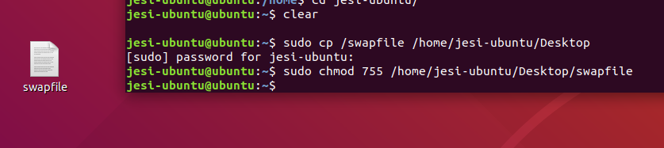 |
|:------------------------------------------------------:|
| *Captura 6 — Copia de la evidencia*       |

### 7. Transferencia de la evidencia al sistema anfitrión o host.
En este paso, transferimos la copia del archivo de intercambio, swapfile, desde Ubuntu hacia el sistema operativo anfitrión y vamos a crear una carpeta llamada **ubuntu_swap** para almacenar la evidencia y utilizarla posteriormente en Autopsy.

| 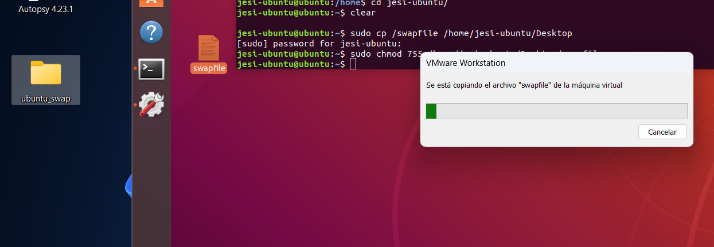 |
|:------------------------------------------------------:|
| *Captura 7 — Archivo de intercambio en el sistema anfitrión*       |

### 8. Verificación de los datos de referencia.
Antes de buscar información en la evidencia, podemos consultar nuevamente el archivo  `/etc/passwd` en Ubuntu.
Utilizando el comando:

    emacs /etc/passwd

En este archivo identificaremos algunos nombres de usuario que después lo utilizaremos como palabras clave durante el análisis.
Para encontrarlos más rapidamente, podemos usar el shorcut  `ctrl + S`, en mi caso buscaré el nombre de usuario `jesi-ubuntu`

En este paso nuestro objetivo sera conocer los datos de referencia que se intentarán localizar en el archivo de intercambio.

| 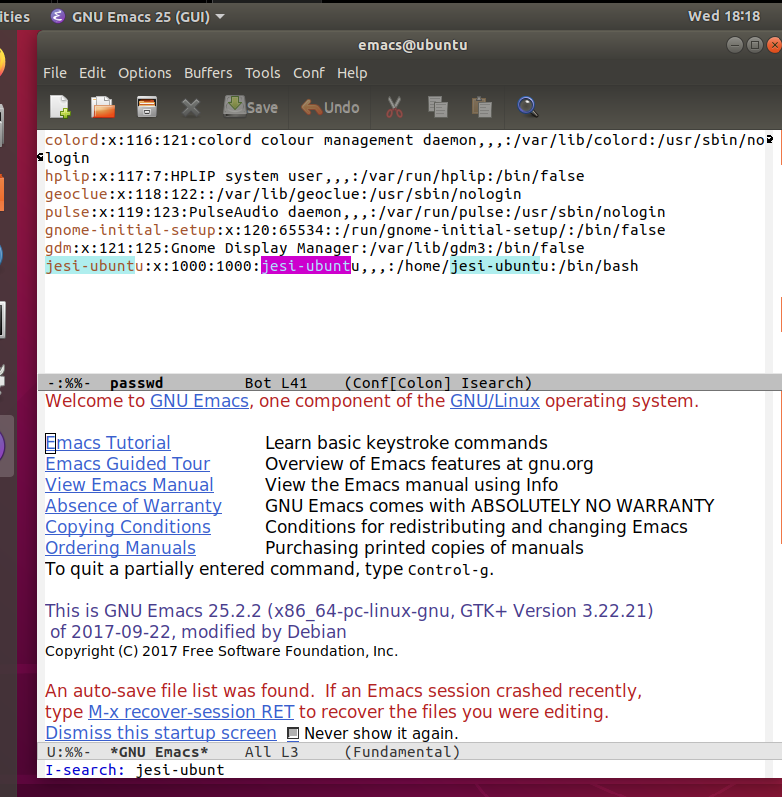 |
|:------------------------------------------------------:|
| *Captura 8 — Contenido de /etc/passwd*       |

### 9. Creación del caso en Autopsy
En este penúltimo paso tenemos que tener previamente instalado Autopsy.
Luego abriremos Autopsy y crearemos un caso nuevo con el nombre **ubuntu_swapfile** y le indicamos en dónde se guardará el caso nuevo de Autopsy.

Posteriormente, agregamos el archivo de intercambio como fuente de datos como tipo de **imagen de archivo sin espacio a alojar**.

| 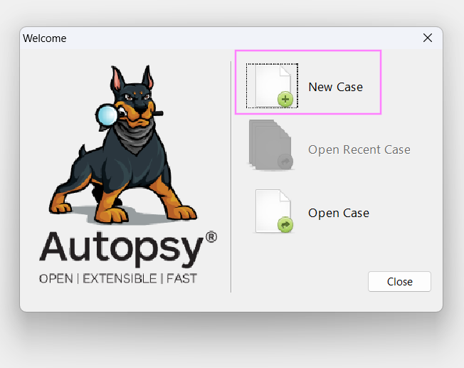 |
|:------------------------------------------------------:|
| *Captura 9.1 — Selección de crear un caso nuevo*       |

| 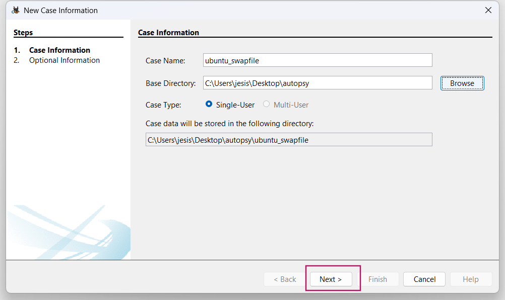 |
|:------------------------------------------------------:|
| *Captura 9.2 — Indicamos el nombre del caso y ruta en donde se guardará*       |

| 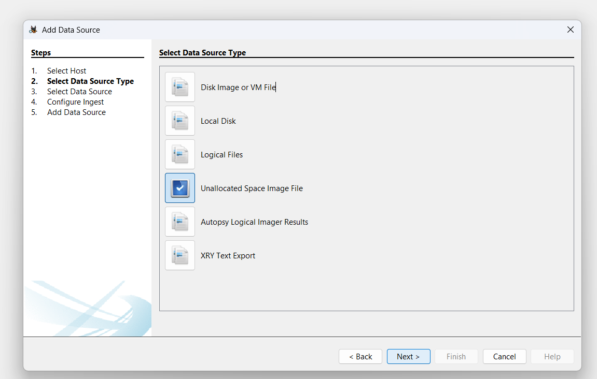 |
|:------------------------------------------------------:|
| *Captura 9.3 — Seleccionamos el tipo de fuente de datos*|

| 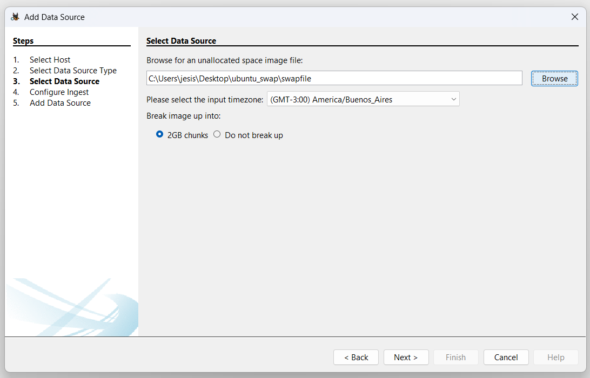 |
|:------------------------------------------------------:|
| *Captura 9.4 — Indicamos la ruta en donde se encuentra nuestro swapfile*|

### 10. Busqueda en Autopsy

Una vez procesada la evidencia, utilizamos la funcionalidad Keyword Search de Autopsy para buscar cadenas de texto.

En este caso, utilizamos las palabras clave `root` y `jesi-ubuntu` para comprobar si el archivo de intercambio conservaba fragmentos de información similares al contenido de `/etc/passwd `.

También observamos que Autopsy permite identificar posibles direcciones de correo electrónico mediante patrones de búsqueda basados en una expresión regular.

| 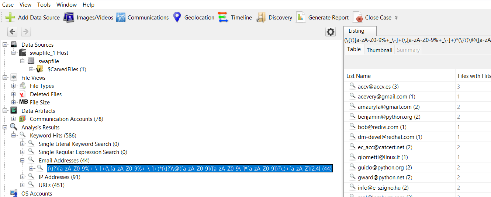 |
|:------------------------------------------------------:|
| *Captura 10.1 — Búsqueda de emails*|

| 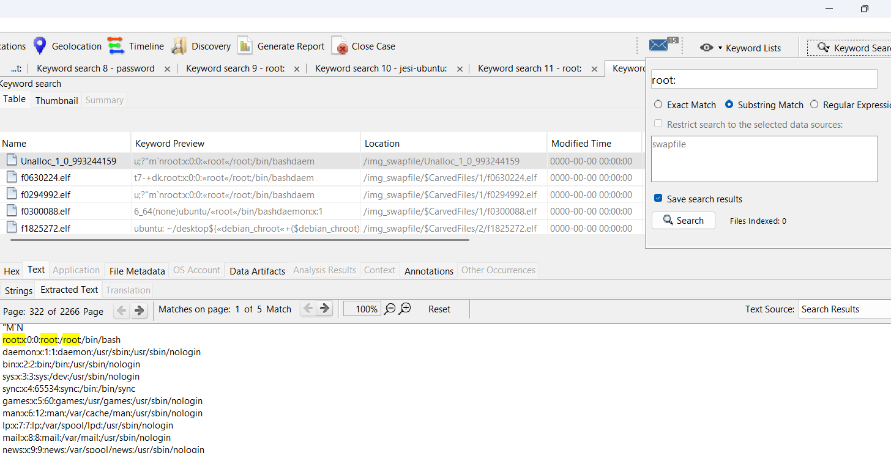 |
|:------------------------------------------------------:|
| *Captura 10.2 — Encuentro de fragmentos del archivo /etc/passwd y busqueda de palabras claves* |

| 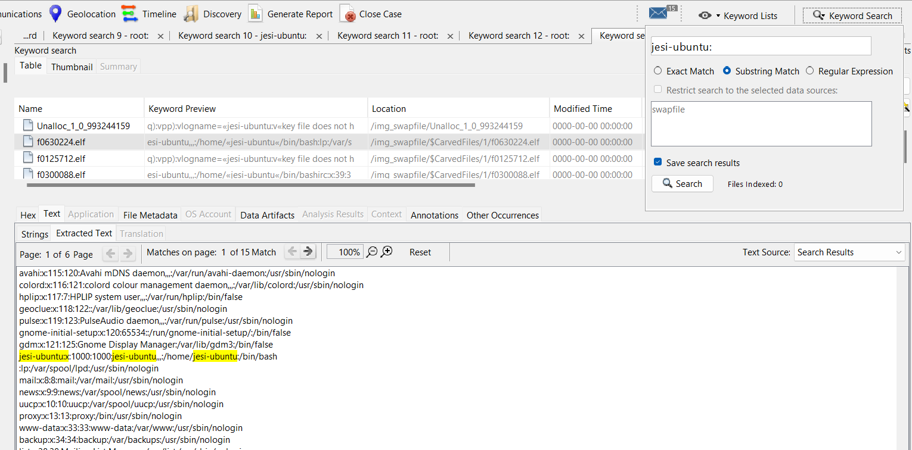 |
|:------------------------------------------------------:|
| *Captura 10.3 — Búsqueda del usuario jesi-ubuntu* |

## Lista de comandos utilizados: 
| Comando | Explicación | Uso en la práctica |
|---|---|---|
| **`sudo apt install tree`** | Instala la herramienta `tree`. | Visualizar la estructura de directorios en forma de árbol. |
| **`tree / -L 1`** | Muestra los directorios y archivos del primer nivel de la raíz `/`. | Identificar la ubicación del archivo `swapfile`. |
| **`ls -lh /swapfile`** | Muestra información del archivo y su tamaño en formato legible. | Verificar el tamaño del archivo de intercambio. |
| **`sudo apt install emacs`** | Instala el editor de texto `emacs`. | Leer, editar archivos. |
| **`emacs /etc/passwd`** | Abre el archivo `/etc/passwd` con el editor Emacs. | Consultar las cuentas de usuario del sistema. |
| **`ps`** | Muestra los procesos con su respectivo PID. | Identificar el PID del proceso Emacs. |
| **`prlimit --as=1000 --pid [PID]`** | Establece un límite al espacio de direcciones virtuales de un proceso. | Limitar la memoria virtual de Emacs para realizar la prueba. |
| **`fg`** | Reanuda en primer plano un proceso suspendido. | Volver a ejecutar Emacs después de aplicar el límite. |
| **`sudo cp /swapfile /home/[usuario]/Desktop/`** | Copia el archivo `swapfile` al Escritorio. | Obtener una copia para analizarla fuera de la máquina virtual. |
| **`sudo chmod 755 /home/[usuario]/Desktop/swapfile`** | Modifica los permisos de la copia del archivo swapfile. | Otorgar permisos de lectura, escritura y ejecución al propietario, y lectura y ejecución al grupo y otros usuarios. |

## Atajos de teclado utilizados

| Atajo | Explicación | Uso en la práctica |
|---|---|---|
| **`Ctrl + Z`** | Suspende temporalmente el proceso y lo pasa a 2do plano. | Suspender Emacs para obtener su PID. |
| **`Ctrl + S`** | Inicia una búsqueda de texto en Emacs. | Buscar nombres de usuario dentro de `/etc/passwd`. |

## Conclusiones:

En esta práctica pude encontrar fragmentos de información similares al archivo `/etc/passwd`, que me permitieron identificar cuentas del sistema como `root`, `daemon`, `bin`, `jesi-ubuntu` y entre otras, junto con sus UID, GID, directorios personales y shells. Esto demuestra que el `swapfile` puede conservar información que estuvo en la memoria RAM, aunque no se recuperó una copia completa del archivo original.

También se identificó que `root` tiene UID 0, lo que permite investigar si existen otras cuentas con privilegios administrativos. Sin embargo, no se encontró otra cuenta con ese UID. Además, se detectaron algunas direcciones de correo electrónico que se podría investigar para conocer su origen.

**Los resultados fueron parciales**, porque el análisis se limitó al archivo `swapfile` y a los fragmentos de información que Autopsy pudo identificar.
